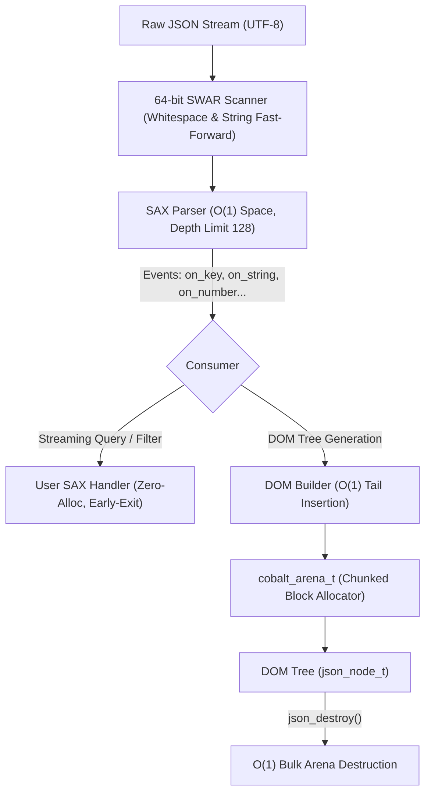

# High-Performance JSON Engine & Streaming SAX Specification

- **Module**: `src/module/json*.c`, `include/cobalt/module/json*.h`
- **Target Standard**: C11, zero external dependencies
- **Author**: Antigravity & Pair Developer
- **Date**: 2026-10-15
- **Status**: Approved Spec

---

## 1. Executive Summary

Cobalt's existing JSON implementation provides a clean, user-friendly DOM interface (`json_parse`, `json_serialize`, `json_tree_get_child`, `json_destroy`). However, performance analysis and code inspection reveal several critical scaling bottlenecks:

1. **$O(N^2)$ Member Insertion**: In `json_parse_object`, each newly parsed key-value pair traverses the entire child linked list from head to tail (`while (tail->next)`) to append. For large objects with hundreds or thousands of keys, insertion cost degrades quadratically.
2. **Extreme Memory Fragmentation**: Every single AST node (`json_node_t`), every member key string (`key`), and every string scalar (`value.string`) is individually allocated via `malloc` (or `cobalt_allocator_alloc`). A document with 10,000 elements triggers 20,000+ tiny heap allocations.
3. **$O(N)$ Recursive Destruction**: `json_destroy` must recursively visit every node and free each key, string, and node individually, incurring severe cache misses and latency spikes during teardown.
4. **Serialization Double Formatting**: In `json_serialize.c`, formatting numbers and strings repeatedly calls `vsnprintf(NULL, 0, ...)` to calculate length, reallocates, and then calls `vsnprintf` a second time to format.
5. **Lack of Streaming / Filtering**: Applications that need to process multi-megabyte JSON payloads or extract single fields must load and retain the entire document in memory as a DOM tree.

### The Solution

This specification introduces a **Single-Pass Streaming SAX Core** accelerated by a **64-bit pure C11 SWAR scanner**, with the existing DOM engine transparently layered on top powered by Cobalt's chunked memory arena (`cobalt_arena_t`).



---

## 2. Architecture & Design Details

### 2.1 64-bit SWAR Scanner & Lexer

To accelerate lexical scanning without introducing non-portable compiler intrinsics (e.g. `_mm256_*`), the lexer employs 64-bit SIMD Within A Register (SWAR) in pure C11.

#### 2.1.1 Whitespace Fast-Forward
Whitespace characters in JSON are `0x20` (space), `0x09` (`\t`), `0x0A` (`\n`), and `0x0D` (`\r`).
Using 8-byte word loading:
- An 8-byte chunk is read if `pos + 8 <= len`.
- An 8-byte bitwise mask tests each byte against the whitespace set.
- If all 8 bytes match, the scan offset advances by 8 bytes in a single cycle.
- Trailing bytes (< 8) fall back to a 256-byte static lookup table (LUT).

#### 2.1.2 String Non-Escaped Scan
JSON strings consist mostly of regular unescaped characters (`>= 0x20`, not `"` and not `\`).
Using a 64-bit SWAR algorithm:
```c
static inline uint64_t has_zero_byte(uint64_t v) {
    return (v - 0x0101010101010101ULL) & ~v & 0x8080808080808080ULL;
}
```
Bytes requiring special attention (`"`, `\`, or control characters `< 0x20`) are detected 8 bytes at a time:
- Compute `mask_quote = has_zero_byte(word ^ 0x2222222222222222ULL);`
- Compute `mask_backslash = has_zero_byte(word ^ 0x5C5C5C5C5C5C5C5CULL);`
- Compute `mask_control = has_zero_byte(word - 0x2020202020202020ULL);`
- If no triggers exist, advance `pos += 8` immediately.
- Once a trigger is detected, the exact byte position is isolated with `__builtin_ctzll` (with portable C fallback).

---

### 2.2 Streaming SAX Engine API (`include/cobalt/module/json_sax.h`)

#### 2.2.1 Event Handler VTable (`cobalt_json_sax_handler_t`)
Each callback receives a caller-supplied context pointer `ctx` and returns a `bool`.
Returning `true` continues parsing; returning `false` aborts parsing immediately (early exit). Any callback set to `NULL` is silently skipped.

```c
typedef struct cobalt_json_sax_handler {
    bool (*on_null)(void *ctx);
    bool (*on_bool)(void *ctx, bool val);
    bool (*on_number)(void *ctx, double val, const char *raw, size_t raw_len);
    bool (*on_string)(void *ctx, const char *val, size_t len);
    bool (*on_key)(void *ctx, const char *key, size_t len);
    bool (*on_start_object)(void *ctx);
    bool (*on_end_object)(void *ctx);
    bool (*on_start_array)(void *ctx);
    bool (*on_end_array)(void *ctx);
} cobalt_json_sax_handler_t;
```

#### 2.2.2 Error Codes & Diagnostics (`cobalt_json_error_t`)
```c
typedef enum cobalt_json_errcode {
    COBALT_JSON_OK = 0,
    COBALT_JSON_ERR_UNEXPECTED_CHAR,
    COBALT_JSON_ERR_UNTERMINATED_STRING,
    COBALT_JSON_ERR_INVALID_ESCAPE,
    COBALT_JSON_ERR_INVALID_NUMBER,
    COBALT_JSON_ERR_UNBALANCED_BRACKETS,
    COBALT_JSON_ERR_DEPTH_EXCEEDED,     /* Exceeded nesting depth limit (128) */
    COBALT_JSON_ERR_USER_ABORTED,       /* Aborted by user callback returning false */
    COBALT_JSON_ERR_INVALID_UTF8,
} cobalt_json_errcode_t;

typedef struct cobalt_json_error {
    cobalt_json_errcode_t code;
    size_t offset;                      /* Byte offset from beginning */
    size_t line;                        /* 1-based line number */
    size_t column;                      /* 1-based column number */
    char message[128];                  /* Human-readable message */
} cobalt_json_error_t;
```

#### 2.2.3 SAX Parse Entry Point
```c
bool cobalt_json_sax_parse(
    const char *json_str,
    size_t len,
    const cobalt_json_sax_handler_t *handler,
    void *ctx,
    cobalt_json_error_t *err
);
```

**Safety Invariants:**
- **Stack Overflow Prevention**: Nesting depth is capped at 128 levels via a compact internal state stack. Inputs exceeding this return `COBALT_JSON_ERR_DEPTH_EXCEEDED`.
- **Zero Heap Allocations**: The SAX parser itself never calls `malloc`. Temporary unescaping is performed in a compact stack buffer (4KB) with direct callback dispatch.

---

### 2.3 DOM Tree Adapter & Arena Memory Management

#### 2.3.1 Internal Unified Node Structure (`src/module/json_internal.h`)
The previously duplicated `struct json_node` in `json.c`, `json_parse.c`, and `json_serialize.c` is consolidated into a single internal header:

```c
struct json_node {
    json_type_t       type;
    json_value_t      value;
    struct json_node *next;
    char             *key;

    /* Internal lifecycle metadata (populated on root node) */
    cobalt_arena_t   *arena;      /**< Non-NULL if memory is backed by an arena */
    bool              owns_arena; /**< True if json_destroy should destroy the arena */
};
```

#### 2.3.2 $O(1)$ Tail Insertion in DOM Builder
The DOM builder maintains a stack of active parent frames:
```c
typedef struct {
    json_node_t *container;  /**< JSON_OBJECT or JSON_ARRAY node */
    json_node_t *tail;       /**< Tail node of the child list */
} dom_frame_t;

typedef struct {
    cobalt_arena_t *arena;
    bool            owns_arena;
    json_node_t    *root;
    char           *pending_key;
    dom_frame_t     stack[128];
    size_t          depth;
} dom_builder_t;
```
When elements or key-value pairs are added, they are linked directly to `tail->next`, upgrading insertion from $O(N^2)$ to strict $O(N)$ for the entire document.

#### 2.3.3 O(1) Bulk Teardown
In `json_destroy` and `json_destroy_with_alloc`:
```c
void json_destroy_with_alloc(json_node_t *node, cobalt_allocator_t *alloc)
{
    if (!node) return;

    if (node->arena) {
        if (node->owns_arena) {
            cobalt_arena_destroy(node->arena);
        }
        return; /* Entire tree and strings reclaimed instantly */
    }

    /* Fallback recursive traversal for manually constructed trees */
    ...
}
```

#### 2.3.4 Public API Extensions
```c
/**
 * @brief Parse JSON text using a user-supplied Arena for allocation
 * @param text JSON string
 * @param arena Backing memory arena
 * @return Root node of the parsed tree (root->owns_arena == false)
 */
json_node_t *json_parse_with_arena(const char *text, cobalt_arena_t *arena);
```
Default `json_parse(text)` internally creates an arena with a default chunk size (4KB), parses the document, and sets `root->owns_arena = true`.

---

### 2.4 Serialization Enhancements (`src/module/json_serialize.c`)

1. **Geometric Buffer Growth**: Initialize buffer capacity to 512 bytes (or estimated from node count) and scale by $2\times$ when full, replacing fine-grained reallocations.
2. **Fast-path String Quoting**: Test strings with SWAR for escape characters. Clean ASCII strings are copied directly with `memcpy` and enclosed in quotes without character-by-character branch evaluation.
3. **In-place Numeric Formatting**: Reserve a 32-byte scratch buffer and format directly into the output buffer, eliminating double `vsnprintf` round-trips.

---

## 3. Testing & Benchmarking Strategy

### 3.1 Unit Testing Suite
- **Regression**: Existing `tests/unit/test_json.c` (43 existing test suites) must pass with zero modifications.
- **New Test File**: `tests/unit/test_json_sax.c`
  - Valid payloads: Scalars, empty objects/arrays, deep nesting, mixed arrays, unicode escapes (`\uXXXX`).
  - Error detection: Unterminated strings, invalid numbers, trailing commas, unmatched brackets, depth exceeding 128.
  - Early-exit semantics: Aborting parsing when finding a target key and verifying correct offset/error status.
  - Arena reuse: Multi-iteration parse and reset with `json_parse_with_arena`.

### 3.2 Performance Benchmarking Suite (`tests/benchmark/benchmark_json.c`)
Integrates into Cobalt's `bench_runner.c` with `--bench json`:
- **SAX Throughput**: MB/s and ops/sec on large payloads (e.g. 500KB GitHub API response).
- **DOM Construction Speed**: Throughput of `json_parse` comparing old discrete `malloc` vs chunked Arena.
- **Destruction Latency**: Nanoseconds to destroy 10,000-node documents (recursive `free` vs $O(1)$ arena destroy).
- **Serialization Throughput**: Output generation speed in MB/s.

---

## 4. Compatibility & Migration Guarantees

| Requirement | Guarantee |
|---|---|
| C Standard | ISO C11 (`-std=c11`), clean compilation with `-Wall -Wextra -Werror` |
| Dependencies | Zero external dependencies (libc only) |
| Public Header ABI | `include/cobalt/module/json.h` remains 100% backward compatible |
| Formatting | Strict compliance with `.clang-format` |
